  <picture>
    <source media="(prefers-color-scheme: dark)" srcset="assets/moonrise-dark.svg">
    
  </picture>

People and machines, tending the same light.

I work on agents that can talk in real time, the tools they use, and the safety around them. Lately I have also been making small 3D worlds that run in a browser.

Most of the interesting problems sit between a person and a machine: what it hears, what it may touch, and who is in charge of it.

[avellan.ai](https://avellan.ai) · [LinkedIn](https://www.linkedin.com/in/joaquinavellan)
